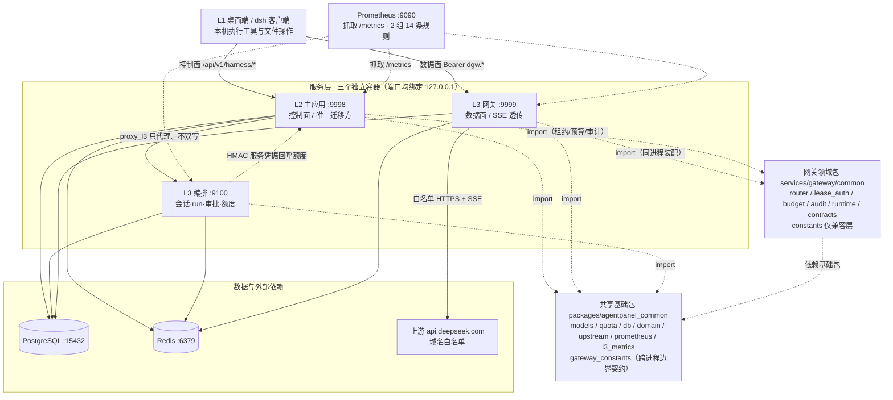
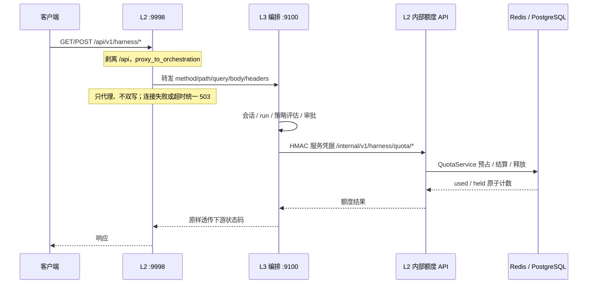
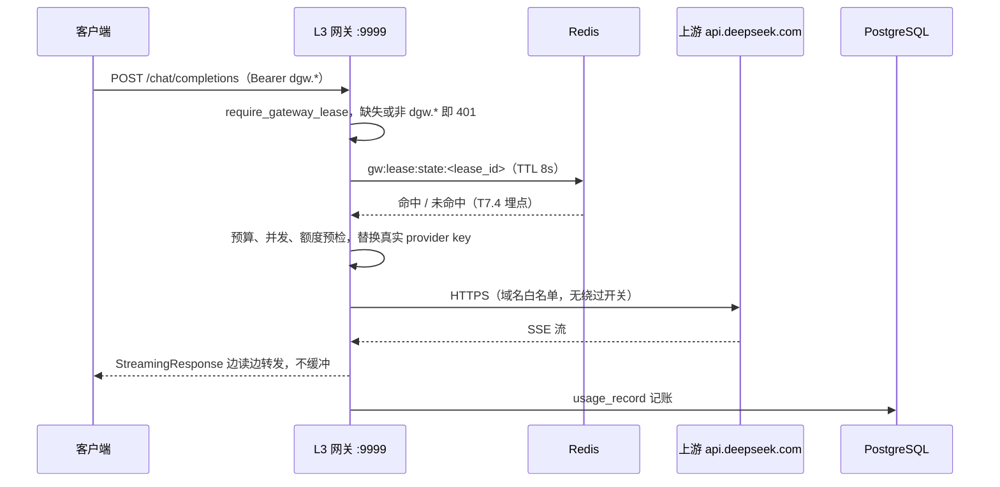

# 现状架构说明（As-Built）：L3 物理拆分后

- 日期：2026-11-09（同日目录整理后修订：网关领域包迁入 `services/gateway/gateway/` 后二次改名 `services/gateway/common/`；网关边界常量下沉共享基础包，编排镜像解耦）
- 状态：**代码现状快照**，非目标态设计稿
- 依据：2026-11-09 工作区代码、`deploy/l3/docker-compose.yml`、`monitoring/`，以及 P6 验收与 T7.4 实测报告
- 关联：`reports/specs/l3-service-split/spec.md`、`reports/ops/l3-split-acceptance.md`、`reports/ops/l3-split-p7-metrics.md`、`reports/ops/l3-split-p7-observation-log.md`

> **边界声明（重要）**
> 1. 本文是**新增文档**，**不修改、不替换** `reports/architecture/agentpanel-architecture.mmd`、`agentpanel-architecture.html` 与 `target-architecture-local-agent.md`。那三份是拆分前的目标态/方向稿资产。
> 2. 正式「更新架构图」属于 T7.5，受 14 天灰度观察期约束（起算 2026-11-09 13:33:40 +0800，最早 2026-11-23 收口）。本文在观察期内提供**可读的现状说明**，不构成 T7.5 的执行，也不改 tasks/checklist 中 T7.5 的状态。
> 3. 判定以**代码为准**。旧图与 spec 中个别「宿主进程」「目标态」表述已过时，差异汇总见 §10。

---

## 1. 结论先行

单仓（monorepo）多进程：一个共享基础包 + 一个网关领域包 + 三个独立容器。**控制面留在 L2，模型数据面与编排面各拆一个进程**，三者共享同一套 PostgreSQL 与 Redis，但**数据库迁移只由 L2 执行**；在 `mode=proxy_l3` 下，客户端的编排请求经 L2 只代理到 L3 编排，额度写主仍回呼 L2 内部 API，从而避免同一 run 双写。Prometheus 作为旁路抓取三个进程的 `/metrics`。

2026-11-09 目录整理后，网关数据面/租约/预算/契约代码从 `packages/agentpanel_common/gateway/` 整包迁入 `services/gateway/gateway/`，同日再改名为 `services/gateway/common/`，导入名统一 `services.gateway.common.*`。它仍是**跨进程共享的领域包**，但仅由 L2（签发租约、看板、embedded 挂载）与网关进程引用；编排只需要的网关边界常量（前缀、虚拟 key 判定、日志/审计标记）已下沉为共享基础包的 `gateway_constants.py`，编排镜像不再复制网关目录。至此 `packages/agentpanel_common` 对 `services.*` 的反向依赖为 0。运行时标识（端口、容器名、compose 服务名、Prometheus job、指标标签、告警表达式）一律未改，观察期指标序列保持连续。

## 2. 分层总览

**依赖规则**：共享基础包是模型/额度/上游客户端与网关边界契约的唯一来源，三个镜像各自 `COPY packages/`（未打 wheel，`run.py` 注入 `sys.path`），导入名统一 `packages.agentpanel_common.*`；L2 通过 `base/*` shim 兼容 re-export。**基础包禁止 `import base.*` 与 `import services.*`**（当前两者均为 0）。网关领域包位于 `services/gateway/common/`，只有 L2 与网关两个镜像复制 `services/__init__.py` 与该包，保证 `services.gateway.common.*` 在这两种进程里是**同一个模块身份**（避免 `runtime.configure()` 注入的配置源分叉）；编排镜像只复制 `packages/`、`services/__init__.py`、`services/orchestration/`，不再包含网关代码。`services.gateway.common.constants` 保留为兼容 re-export 层，定义已下沉至 `packages/agentpanel_common/gateway_constants.py`（见 §4.1、§9）。

## 3. 三个服务

| 服务 | 代码入口 | 容器启动命令 | 端口 | 健康端点 | 职责 |
|---|---|---|---|---|---|
| **L2 主应用** | `base/start.py` 建 app → `base/app_wrapper.py` 加 `/api` 前缀 → `run.py` 起 uvicorn | `CMD ["python","run.py"]`（`deploy/l3/Dockerfile.l2:60`） | `9998` | `/health/health`、`/api/health/health` | 租约签发、策略/凭据/出网策略 CRUD、看板与报表、对 L3 暴露内部额度与心跳 API；**唯一执行 aerich 迁移的进程**；`/metrics`（`start.py:733`） |
| **L3 网关** | `services/gateway/run.py` → `app/main.py` → `gateway/router.py`（领域包同目录） | `CMD ["python","services/gateway/run.py"]` | `9999` | `/health`、`/health/health`、`/health/live` | `dgw.*` 虚拟 key 鉴权、provider 转发 SSE 透传、`usage_record` 记账、预算/并发/额度耗尽预检 |
| **L3 编排** | `services/orchestration/run.py` → `app/main.py` | 同构；compose 覆盖 command 注入 secret 后 `exec run.py`（`docker-compose.yml:134-137`） | `9100` | `/health/health`、`/health/live`、`/health/ready`、`/health/orchestration` | 会话/run/step 编排、策略评估、审批、审计；额度**不自己写主**，经 L2 内部 API |

编排的路由前缀：`/v1/harness`（`api/business.py:24` 读、`api/write.py:32` 写）、`/v1/harness/approvals`（`api/approval.py:13`）、`/internal/v1/harness`（`api/internal.py:11`，含 `/whoami`）。`/metrics` 不纳入业务鉴权（`main.py:167-172`）。

### `orchestration.mode` 二元灰度开关

| 取值 | 写主 | 行为 |
|---|---|---|
| `l2` | L2 本地 | 维持 L2 行为；L3 在 `mode != proxy_l3` 时拒绝写（409），避免同一 run 双写 |
| `proxy_l3`（当前） | L3 编排 | L2 对已迁移编排路径**只代理、不双写**；下游不可达统一 503，不回落本进程 |

校验仅允许这两个值（`services/orchestration/app/config.py:122-123`）。这是**部署级整机二元切换**，没有按比例/按租户切流；切流与回切都是整机行为。

## 4. 共享基础包 `packages/agentpanel_common` 子系统

| 模块 | 职责 |
|---|---|
| `config.py` | INI / ENV / `*_FILE` 契约，缺失即 fail-closed（退出码 2） |
| `db.py`、`models/`、`domain/` | Tortoise 连接工厂、模型单一来源、run/event/policy/approval/audit/pricing 等领域对象 |
| `quota/` | `quota_service.py`（预占/结算/释放）、`plan_service.py`、`plan_resolver.py`、`metrics.py` |
| `upstream/` | `client` / `config` / `egress`，强制出网域名白名单，无绕过开关；**L2 的 10 个 LLM 插件经 `base/common/upstream` shim 与网关共用同一实现**，故不属于网关专属 |
| `gateway_constants.py` | 网关边界契约：`/v1/gateway` 前缀、`dgw.*` 虚拟 key 判定、日志 sink 标记、审计来源；纯常量/纯函数，无依赖，供 L2 / 网关 / 编排三方共用 |
| `security.py` | HMAC-SHA256 服务凭据签名，L2 与 L3 共用 |
| `prometheus.py` | 共享 registry、HTTP 指标与 `metrics_endpoint`（L2 使用） |
| `l3_metrics.py` | T7.4 新增：纯 ASGI HTTP 中间件、业务计数器、`/metrics` 端点构造（两个 L3 服务使用） |
| `cache.py` / `log.py` / `masking.py` | Redis 缓存封装、日志、脱敏 |

### 4.1 网关领域包 `services/gateway/common`（2026-11-09 整包迁入并二次改名）

| 模块 | 职责 | 主要使用方 |
|---|---|---|
| `router.py` | `/health`、`/chat/completions` 数据面路由与 SSE 透传 | 网关 |
| `service.py` | 出网白名单断言、上游 URL 构造、用量解析与记账 | 网关 |
| `auth.py` / `lease_auth.py` | `dgw.*` 租约鉴权、Redis 短缓存（TTL 5–10s） | 网关、L2（复用租约校验） |
| `budget.py` | 额度/预算/并发预检、流式看门狗、耗尽自动吊销 | 网关、L2（看板与签发） |
| `audit.py` / `logging.py` | 网关审计事件、独立日志 sink | 网关、L2 |
| `lease_revoke.py` | 租约吊销共享实现 | 网关、L2 |
| `runtime.py` | 配置源注入访问器（`configure()` 由各入口启动时调用一次） | 网关、L2 |
| `contracts.py` | 错误码、幂等/缓存键前缀等稳定契约 | 网关、L2 |
| `constants.py` | **兼容层**：re-export `packages.agentpanel_common.gateway_constants`，保留历史导入名 | 外部/历史引用；包内已不引用 |
| `app.py` | embedded 形态的 FastAPI 子应用（L2 挂载用） | L2 |

**布局**：`services/__init__.py`、`services/gateway/__init__.py` 让 `services.gateway.common.*` 成为常规包路径。注意仓库内有三个易混淆的 `common`：`services/gateway/common/` 是**网关领域包**（仅 L2 与网关共用）、`packages/agentpanel_common/` 是**跨进程共享基础包**（三进程共用）、`base/common/` 是 L2 侧的兼容 shim 与工具层；三者层级与职责不同，不要互相替代；`services/gateway/app/` 仍是进程装配层（config / health / main），`run.py` 是启动器，`tests/` 与 `manifest.json` 保持原位。包内同包依赖用相对导入（`.logging` 等），跨包依赖一律改为绝对导入 `packages.agentpanel_common.*`（迁移前是 `..` 相对导入）。

**共享包下四个子包为何不迁入 service**：`domain/`（全仓 57 条 import）、`models/`（43 条）、`quota/`（18 条）、`upstream/`（12 条）都被 L2、网关、编排及包内交叉引用。尤其 `upstream/` 看似网关专属，实际 L2 的 10 个 LLM 插件通过 `base/common/upstream` 兼容层调用它。把任一子包归入某个 service，都会让另外两个进程反向依赖服务目录，因此维持 `packages/agentpanel_common/` 作为跨进程内核。仅把**无依赖的纯契约** `gateway_constants.py` 放在基础包。

**为什么用纯 ASGI 中间件**：`services/gateway/common/router.py` 的 `/chat/completions` 用 `StreamingResponse` 边读边转发；共享基础包里的 `PrometheusMiddleware` 基于 `BaseHTTPMiddleware`，会包装响应并可能缓冲 SSE。T7.4 因此新增 `L3HttpMetricsMiddleware`（纯 ASGI），并用 `scope["path_params"]` 折叠动态段控制标签基数。

## 5. 运行时链路

### 5.1 编排链路（`mode=proxy_l3`）

关键实现：`base/plugins/harness/services/orchestration_proxy.py:56-102`（转发与 503 收敛）；L2 内部额度路由 `base/plugins/harness/api/l2_internal/quota_router.py:21`（`prefix=/internal/v1/harness/quota`）；编排侧客户端 `services/orchestration/app/l2_quota_client.py`（超时/5xx → 503）。

**为什么额度要回呼 L2**：让配额写主保持单点，L3 编排持只读 DB 账号 + `information_schema` schema 断言 fail-closed，避免两个进程同时写账本。

### 5.2 网关链路（数据面）

两条链路彼此解耦：L2 **不参与任何 SSE 帧**；网关不参与编排业务。

### 5.3 内部鉴权

服务凭据由 `orchestration_service_secret` secret 分发，L3 编排侧 `app/auth.py` 只接受 HMAC 签名（`ServiceAuthError` 默认 401），与共享 `security.py` 共用签名算法。L2 侧 `service_auth.py` 与 `quota_router.py` 在非 `proxy_l3` 时拒绝内部额度调用。编排容器固定 IP `172.28.0.10`，配合 `ORCH_INTERNAL_ALLOWED_IPS` 精确匹配（不能写 CIDR）。

## 6. 数据模型与 Redis key

| 类别 | 键 / 表 | 用途 |
|---|---|---|
| 配额 used | `quota:{ot}:{oid}:{item}:{period}` | 原子计数（`quota_service.py`，`counter_mode=redis`） |
| 配额 held | `quota_held:{ot}:{oid}:{item}:{period}` | 预占中的量 |
| 单次预占 | `quota_hold:{hold_id}` | hash，TTL 3600s |
| 悬挂索引 | `quota_holds_index`（zset） | 过期扫描与对账 |
| 并发槽 | `conc:{ot}:{oid}` / `conc:global` | 并发限制 |
| 租约缓存 | `gw:lease:state:<lease_id>` | TTL 8s（限 5–10s），吊销后最多 8s 内仍可能被接受，是已记录的语义边界 |
| 事实源 | PG `usage_record` / `quota_reservation` | 计费权威账本；`quota_reservation.hold_id` 唯一约束兜底幂等 |
| 幂等前缀 | `gw:` / `harness:` / `orch:` | 请求幂等键 |

PostgreSQL 位于 `host.docker.internal:15432`（Tortoise ORM + asyncpg），Redis 网络别名 `agentredis:6379`。**Redis 是硬依赖，不是可选项**。

## 7. 部署拓扑

`deploy/l3/docker-compose.yml` 三个服务：

- 端口全部绑定宿主 `127.0.0.1`（`9998/9999/9100`），容器内 `0.0.0.0`；`restart: unless-stopped`，`no-new-privileges:true`，json-file 日志轮转 10m×3。
- external 网络 `agentpanel-net`（需预先 `docker network create --subnet 172.28.0.0/16 agentpanel-net` 并热接入 `agentredis`）；编排固定 IP `172.28.0.10`；三个服务都加 `host.docker.internal:host-gateway`。
- L3 网关与编排 `read_only: true` + `/tmp` tmpfs；编排 `depends_on: l2: service_healthy`。
- 4 个 secrets（`deploy/l3/secrets/`，不入库）：`db_password`、`redis_password`、`orchestration_service_secret`、`l2_config`（挂为 `/app/config.conf`，mode 0444）。配置通过 `*_FILE` 读取。
- `RUN_DB_MIGRATIONS: "false"`，迁移不随容器启动执行，需一次性任务单独跑。
- `prepare-secrets.ps1` 生成的 `.env` 仍写旧端口 `19999/19100`（第 140-141 行），重建 secrets 后需手工改为 `9999/9100`——as-built 时点的已知遗留缺陷（**2026-11-09 16:44 已修复为直接生成现行端口，见 `reports/ops/l3-split-p7-metrics.md` §8.1；本节保留基线快照原文**）。

## 8. 可观测（T7.4 之后）

| 项 | 现状 |
|---|---|
| 指标端点 | L2 `9998/metrics`、L3 网关 `9999/metrics`、L3 编排 `9100/metrics`；两 L3 复用共享 registry，DB/Redis 健康 Gauge 随抓取刷新 |
| 抓取 job | `monitoring/prometheus.yml` 共 6 个：`prometheus`、`aipaneladmin`(9998)、`l3-gateway`(9999)、`l3-orchestration`(9100)、`pushgateway`、`node_exporter` |
| 告警规则 | `monitoring/alert_rules.yml`：2 组共 14 条 —— `aipaneladmin_alerts` 4 条、`l3_split_alerts` 10 条（对齐灰度 R1–R6） |
| 通知 | `alerting.alertmanagers` 的 targets **为空**，规则求值但不外发通知，需人工查看 `/alerts` |
| 端口避让 | `node_exporter` 宿主 `9101:9100`（9100 已被 L3 编排占用）；`alert_rules.yml` 已在 compose 中补挂 |
| 巡检 | `deploy/l3/scripts/observe_check.py` 16 项只读检查，逐日写入观察期台账 |

## 9. 架构级已知限制

1. 三端口仅回环绑定、**无 TLS 终止**；远程客户端需本机代理/隧道。
2. `web_fetch` / `web_search` 是 dsh 工具侧的直接出网通道，**绕过共享上游客户端与网关白名单**；`egress_policy_service.py` 的 `tool_denylist` 只是策略快照不是执行边界。Linux 实测联网容器访问 `https://example.com/` 返回 200。生产必须禁用这些工具或用容器/网络策略兜底。
3. DSH 原生审批无终端应答者：`approval/asked` 与 `approval/decided` 成对产生但 `outcome=unavailable`，依赖后端事件落库 + 超时拒绝的 fail-closed 路径。
4. 灰度只有部署级整机二元切换，无百分比/按租户切流。
5. 配额正确性（重复结算、`used` 多加、预占悬挂）与数据一致性仍按每日人工 G1 抽查，Prometheus 无法判定；离线结算 outbox 未做（P2 技术债）。
6. 对账触发仍在 L2（`reconcile_in_l3=false`），未迁移到 L3。
7. **剩余分层取舍**：网关边界常量已下沉为 `packages/agentpanel_common/gateway_constants.py`，`log.py` 的反向 import 消除、编排镜像不再复制网关目录（本次修订）。仍保留的取舍是：网关领域包位于 `services/gateway/common/` 但 L2 也引用它（签发租约、看板、embedded 挂载），所以 L2 镜像必须复制该目录；`contracts.py` 仍留在网关服务目录内且当前无外部引用。若要严格单向，应把 `contracts.py` 一并下沉，或把 L2 侧对网关领域包的引用收敛为独立共享包。

## 10. 与旧目标态架构图的差异对照

对照 `reports/architecture/agentpanel-architecture.mmd`（拆分前目标态）：

| 项 | 旧图 | 代码现状 | 影响 |
|---|---|---|---|
| 网关 chat 路径 | `POST /v1/gateway/chat/completions` | 独立网关 `POST /chat/completions`（`gateway/router.py:200`）；L2 仍保留 `/api/v1/gateway` 前缀隔离分支（`app_wrapper.py:58-64`），但那不是 L3 网关入口 | 按旧图调用会 404 |
| Redis | 「当前未启用」+ `:::planned` 虚线 | 三服务 `REDIS_ENABLED="true"`（compose `:40/:83/:123`）；配额、租约缓存、限流均依赖它 | 从「可选」变成硬依赖 |
| PostgreSQL | `5432` | `host.docker.internal:15432`（compose `:35-36` 等） | 连接串不同 |
| 编排入口 | dsh「⑥ HTTPS 9100 客户端凭据」直连 CAPI | `proxy_l3` 下客户端走 `9998 /api/v1/harness/*`，L2 只代理到 `http://l3-orchestration:9100`（compose `:47`）；编排直连主要用于本机验证/内部 | 调用拓扑变了 |
| 租约缓存 | 「Redis 可选」虚线 | `gw:lease:state:<id>` TTL 8s 为实际路径，T7.4 已有命中/未命中埋点 | 缓存行为已落地 |
| TLS | 标注 `HTTPS 9998/9999/9100` | `127.0.0.1` 回环 HTTP，无 TLS 终止 | 安全边界不同 |
| 可观测层 | 图中无 | Prometheus `:9090` 抓三服务 `/metrics`，2 组 14 条规则 | 新增旁路层 |
| 只读 DB / 对账未迁移 | `RDB 只读账号`、`RECON 未迁移 L3` | **仍成立** | 与目标态一致 |

另外 `spec.md` §11 的数据流 ASCII 图标注「L2 业务后端 :9998（宿主进程）」也是拆分前表述，现在 L2 同样是容器；以 §7 与 compose 为准。

## 11. 代码索引

| 关注点 | 文件 |
|---|---|
| L2 应用构建与前缀 | `base/start.py`、`base/app_wrapper.py:289`、`run.py` |
| 编排代理（只代理/503） | `base/plugins/harness/services/orchestration_proxy.py:56-102` |
| L2 内部额度路由 | `base/plugins/harness/api/l2_internal/quota_router.py:21` |
| 网关进程装配与启动 | `services/gateway/app/main.py`、`app/config.py`、`run.py` |
| 网关领域包与包边界 | `services/gateway/common/`、`services/__init__.py`、`services/gateway/__init__.py` |
| 网关边界契约（三方共用） | `packages/agentpanel_common/gateway_constants.py`；兼容层 `services/gateway/common/constants.py` |
| 网关数据面路由 | `services/gateway/common/router.py:190,200`、`lease_auth.py` |
| 三镜像代码复制规则 | `services/gateway/Dockerfile`、`services/orchestration/Dockerfile`、`deploy/l3/Dockerfile.l2` |
| 编排 app 与路由 | `services/orchestration/app/main.py:159-172`、`app/api/*.py` |
| 额度回呼客户端 | `services/orchestration/app/l2_quota_client.py` |
| 配额服务与 key | `packages/agentpanel_common/quota/services/quota_service.py:30-32,127-140` |
| 监控中间件 | `packages/agentpanel_common/l3_metrics.py`、`prometheus.py` |
| 部署 | `deploy/l3/docker-compose.yml`、`deploy/l3/Dockerfile.l2`、`services/*/Dockerfile` |
| 监控配置 | `monitoring/prometheus.yml`、`alert_rules.yml`、`monitoring-deployment.yml` |

## 12. 维护说明

- 本文记录 2026-11-09 的代码现状；观察期内（最早 2026-11-23 收口）**不修改现有架构图资产**。
- T7.5 执行时，应以本文 §2、§5、§10 为输入，把 `agentpanel-architecture.mmd`（及其 HTML 渲染）更新为最终态，并同步 `spec.md` §11；届时本文可作为「as-built 基线」保留归档。
- 所有判定以代码为准；若实现变更，先改代码再更新本文，不要反向以文档推定实现。

### 2026-11-09 目录整理变更记录

| 变更 | 前 | 后 |
|---|---|---|
| 服务目录去 `l3` 前缀 | `services/l3-gateway/`、`services/l3-orchestration/` | `services/gateway/`、`services/orchestration/`（提交 `22d40c9`） |
| 网关领域包归入服务 | `packages/agentpanel_common/gateway/`（13 模块 + `__init__.py`，2663 行） | `services/gateway/gateway/`，导入名 `services.gateway.gateway.*`（提交 `7be9c13`） |
| 网关边界常量下沉 / 编排解耦 | `log.py` 反向引用网关包、编排镜像复制网关目录 | `packages/agentpanel_common/gateway_constants.py`；编排不再复制网关目录（提交 `2103fca`） |
| **领域包二次改名** | `services/gateway/gateway/`，导入名 `services.gateway.gateway.*` | `services/gateway/common/`，导入名 `services.gateway.common.*`（本次） |
| 包边界 | `services/` 无 `__init__.py` | 新增 `services/__init__.py`、`services/gateway/__init__.py` |
| 镜像复制 | L2 只复制 `services/*/manifest.json`；编排不复制网关代码 | 整包迁移时三镜像均复制；**常量下沉后编排恢复为不复制网关目录**，仅 L2 与网关复制网关领域包 |
| 验证脚本 | 挂载 `packages/agentpanel_common/gateway/service.py` | 挂载 `services/gateway/common/service.py`；stub 模块链同步为 `services.gateway.common.*` + `packages.agentpanel_common.*` 两级 |
| 网关边界常量 | 定义在 `services/gateway/gateway/constants.py`，`log.py` 反向引用、编排需复制网关包 | 定义下沉至 `packages/agentpanel_common/gateway_constants.py`；原路径保留 re-export 兼容层；`packages` 对 `services.*` 反向依赖归零 |
| 编排依赖 | `app/auth.py` 引用 `services.gateway.gateway.constants` | 改引共享基础包 `gateway_constants`；编排 Dockerfile 去掉两条网关包 `COPY` |

本次二次改名同步了全仓 22 文件 / 63 处路径（L2 插件、两个 Dockerfile、Linux 验证链、reports），包内 13 个文件由 `git mv` 保留 rename 历史；`out*/` 原始证据仍保留当时字面量。

保持不变：端口 `9998/9999/9100`、compose 服务名 `l2/l3-gateway/l3-orchestration`、容器/镜像名 `agentpanel-l3-*`、manifest `name`、Prometheus 6 个 job 与 14 条告警表达式、指标 `service` 标签、巡检白名单、观察期起算时间与台账。历史报告与 spec 中的**路径表述**已同步为新路径；`deploy/harness-linux-verify/out*/` 内的原始证据 JSON/JSONL 保留当时字面量，未改写。
