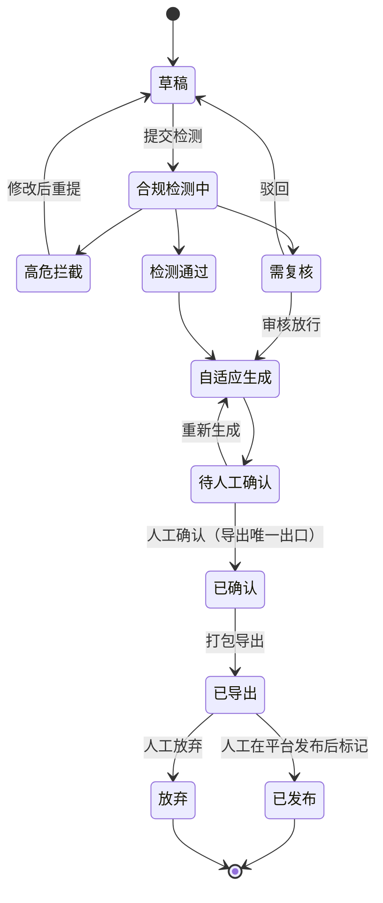
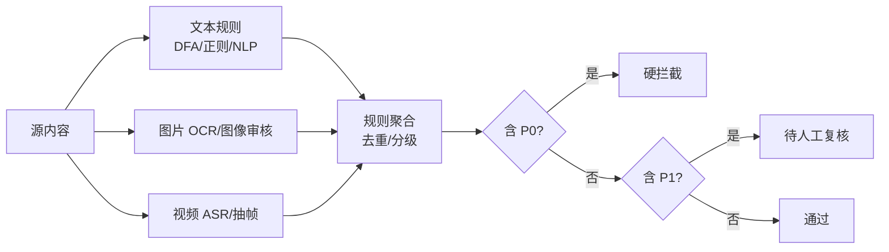
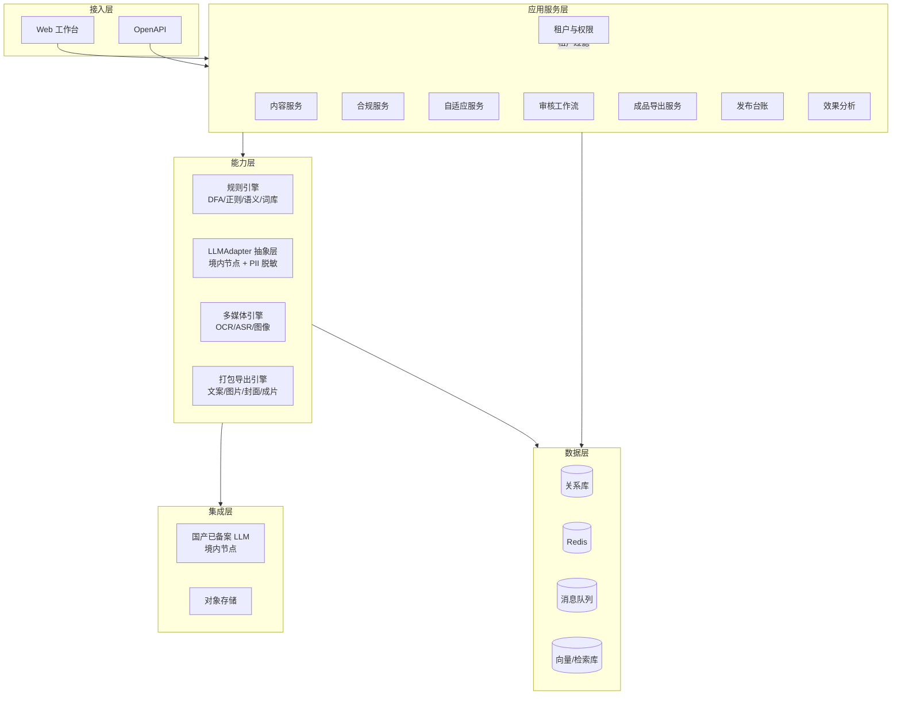

# ContentOps · 多平台自媒体内容合规与自适应处理台 PRD

| 项 | 内容 |
|---|---|
| 文档版本 | v1.2（发布层收敛：系统内处理，人工发布） |
| 创建日期 | 2026-11-17 |
| 需求场景 | 代码开发 / 新模块立项 |
| 适用范围 | 产品、研发、测试、合规、内容运营 |
| 产品一句话 | 一次创作，自动合规、自动适配，各平台成品导出后人工发布 |

---

## 0. 决策锁定记录

### 0.1 当前决策（v1.2，2026-11-17 收敛后生效）

| # | 决策项 | 确认结论 | 说明 |
|---|---|---|---|
| D1 | 发布边界 | **系统内处理，人工发布** | 系统不连接任何平台、不做自动发布；合规+自适应处理后的成品导出，由人复制到各平台手动发布 |
| D2 | 目标平台 | **5 个平台作为适配目标**（公众号/微博/小红书/抖音/头条） | 仅作为内容适配规格来源，不涉及平台 API 对接 |
| D3 | LLM 方案 | **第三方 API，可切换抽象层，供应商待定** | 统一 `LLMAdapter` 接口，运行时切换；强制境内节点 |
| D4 | 视频范围 | **元信息适配 + 允许外部成片**（N2 修订） | 做标题/封面/话题适配，可上传外部成片；不自动剪辑。人工发布时由人上传成片 |
| D6 | 规则来源 | **先用开源词库** | 零采购成本起步，后续可替换采购/自建库 |
| D7 | 多租户 | **多租户隔离** | 全表 `tenant_id`，全局租户过滤，配额独立 |
| D8 | LLM 出域 | **三条件方案**（见卡点报告） | 境内节点 + DPA 三条款 + PII 脱敏；法务单点确认，开发不阻塞 |
| D9 | 数据回流 | **人工回填 + 可选第三方监测** | 系统不自动抓平台数据；提供发布台账，运营手工回填阅读/互动数据 |

> **v1.2 范围提示**：发布层整体移除后，不再有平台资质申请、API 权限、RPA、联调等外部依赖。M1 从"6 周 + 5 平台联调"收缩为纯内部系统开发，周期显著下降。

### 0.2 历史决策变更（v1.0/v1.1，已被 v1.2 取代，留档）

| # | 旧决策 | 变更原因 |
|---|---|---|
| D1 旧 | 人工确认后发（系统仍连平台发布） | 第三方调研后，用户选择彻底移除发布动作 |
| D5 | 允许 RPA 降级 | 发布层移除，RPA 不再需要 |
| N1 | 小红书半自动导出通道 | 升级为全平台统一"人工发布"，小红书特例取消 |
| A5/A6 | 头条 API 实测 / 平台资质申请 | 不接平台 API，全部消解 |

---

## 1. 背景与问题陈述

| # | 现状痛点 | 量化影响（需运营侧复核） |
|---|---|---|
| P1 | 同一内容要在 5–8 个平台重复编辑、改标题、配图、加话题 | 单条内容跨平台处理平均耗时 30–45 分钟 |
| P2 | 广告法违禁词、医疗金融敏感表述靠人工记忆，漏检频发 | 《广告法》第 9 条最高可处 20–100 万元罚款；平台限流/删文更常见 |
| P3 | 各平台格式与调性不同，直接搬运"水土不服" | 搬运内容互动率普遍低于原生内容 30%+ |
| P4 | 审核无留痕，出问题无法追溯"谁改的、用什么规则" | 合规事故复盘成本高，责任难界定 |
| P5 | 规则散落在 Excel/口头，平台规则更新后无人同步 | 规则滞后导致批量违规 |

**结论**：需要一个把「内容生产 → 合规校验 → 自动适配 → 审核 → 成品导出 → 人工发布 → 数据回填」串起来的处理台，将合规从"人肉兜底"变成"系统强控"。**发布动作刻意留在系统外，规避平台 API/RPA 的资质、封号与合规风险。**

---

## 2. 产品定位与目标

### 2.1 定位
- **不是**自动发布工具，而是**以合规为硬闸门、以自适应为核心能力的内容处理台**。
- 系统职责边界止于"产出合规、适配好的各平台成品"，并一键导出。
- 合规是**强制关卡**：P0 高危内容无法导出，P1 需审核员放行。
- 发布由人工在各平台完成，系统通过"发布台账"跟踪状态、人工回填效果数据。

### 2.2 目标（可度量，作为验收依据）

| 目标 | 基线 | 目标值 |
|---|---|---|
| 违禁词/高危内容漏检率 | 人工抽检漏检 ~5% | < 0.5%（受 D6 开源词库限制，见注） |
| 单条内容多平台成品处理+导出耗时 | 30–45 min | ≤ 5 min（-85%） |
| 因内容合规导致的下架/限流事件 | 现状基线 | 下降 ≥ 80% |
| 自适应后内容互动率 | 原生搬运基线 | A/B 验证提升 ≥ 15% |
| 处理全链路可追溯率 | ~0 | 100%（谁/何时/何规则/何版本） |

> 注：D6 开源词库起步，漏检率目标在升级为采购/自建库前需下调预期。

---

## 3. 用户与核心场景

### 3.1 角色
| 角色 | 职责 | 关键诉求 |
|---|---|---|
| 内容运营（Creator） | 创建源内容、确认自适应成品、导出并人工发布 | 少重复编辑、合规有保障 |
| 合规审核员（Reviewer） | 复核中危内容、驳回/放行、维护规则 | 风险可控、判定有据、留痕可查 |
| 租户管理员（Tenant Admin） | 本租户的规则、成员、配额 | 租户内统一管控 |
| 平台管理员（Admin） | 全平台租户、规则库、系统配置 | 全局管控与审计 |

### 3.2 核心用户故事（含验收标准）

**US-1 一次创作多平台成品**
> 作为运营，我写一份源内容，系统自动生成 5 个平台的合规成品，我确认后打包导出，再去各平台手动发布。
- AC1：源内容含标题、正文（富文本）、图片/视频引用、话题等结构化字段
- AC2：每个平台成品独立可编辑，修改不影响源内容与其他平台成品
- AC3：导出按平台分目录打包（文案 .md/.txt + 图片 + 封面 + 成片），可直接复制使用

**US-2 发布前合规硬拦截**
> 作为运营，我提交内容后系统立刻标出所有风险点和依据，高危内容无法导出。
- AC1：检测覆盖文本、图片内文字（OCR）、视频语音（ASR）与关键帧
- AC2：每个命中项展示：命中词/句、位置、风险等级、依据条款、替换建议、置信度
- AC3：P0 硬拦截无"强制导出"入口；P1 需审核员放行

**US-3 自动自适应**
> 作为运营，系统按平台规则自动改写标题、裁剪正文、换文风、配话题、转图片规格。
- AC1：每个平台至少生成 1 个可用成品，标题生成 ≥ 3 候选
- AC2：适配后内容满足目标平台字数/尺寸/格式约束（自动校验）
- AC3：所有 AI 改写可追溯到"原句 → 改句"diff，支持一键回退
- AC4：AI 能力经 `LLMAdapter` 抽象层调用，可无感切换供应商（D3）

**US-4 审核与留痕**
> 作为审核员，我看到待复核队列，判定后系统记录完整审计链。
- AC1：审计记录含操作人、时间、IP、租户、规则版本、命中详情、判定结果
- AC2：审计日志不可删除，仅可追加

**US-5 发布台账与数据回填**
> 作为运营，我在台账里标记每个平台成品是否已发布，并手工回填阅读/互动数据。
- AC1：台账状态：待发布 / 已发布 / 放弃，可记录计划发布时间与实际发布时间
- AC2：支持手工回填阅读/点赞/评论等数据；支持导入第三方监测工具（如千瓜、蝉妈妈）导出的 CSV
- AC3：按平台聚合对比，评估适配效果

**US-6 租户隔离（D7）**
> 作为租户管理员，我只看到本租户的内容、规则与成品，无法感知其他租户存在。
- AC1：所有业务表带 `tenant_id`，所有查询强制带租户过滤
- AC2：跨租户访问返回 404/403，且写入审计日志
- AC3：租户间规则库、词库完全隔离，配额独立

---

## 4. 范围界定

**In Scope（本期）**
- 目标平台（仅适配规格）：微信公众号、微博、小红书、抖音、今日头条 5 个
- 内容形态：图文为主；视频做元信息/封面/话题适配，支持上传外部成片（D4），不自动剪辑
- 合规（D6）：文本 + 图片 OCR + 视频 ASR/关键帧；开源词库起步
- 自适应：标题/正文/文风/话题/图片规格；AI 改写走可切换抽象层（D3）
- 审核流（D1）：人工确认闸门，P0 硬拦截
- 成品导出：按平台打包（文案+图片+封面+成片）
- 发布台账 + 人工数据回填（D9）
- 多租户隔离（D7）、OpenAPI

**Out of Scope（本期不做）**
- 任何形式的平台自动发布（官方 API、RPA、第三方聚合均不接）
- 平台账号凭证托管、平台资质申请
- 自动抓取平台互动数据
- 自动视频剪辑/混剪、自动配音
- 平台私信/评论自动回复、刷量/诱导分享
- 面向 C 端消费者的独立 App

---

## 5. 功能需求清单（按优先级）

### 5.1 内容中心（P0）
- 结构化源内容模型：标题、正文（富文本）、图片列表、视频引用、话题、摘要、封面
- 素材库：图片/视频上传、标签、复用（租户内隔离）
- 版本管理：源内容 ↔ 各平台成品，支持 diff 与回退

### 5.2 合规引擎（P0，核心）
**规则库分层**
| 层 | 内容 | 举例 | 来源 |
|---|---|---|---|
| L1 法律法规 | 广告法绝对化用语、禁用词、特殊行业 | "最/第一/国家级/顶级/包治/稳赚不赔" | 开源词库（D6） |
| L2 行业规则 | 医疗、金融、教育、房地产、酒类、烟草、未成年人 | "根治""保本保息""升学保证" | 开源词库 + 自建 |
| L3 平台规则 | 各平台社区规范、外链引流、诱导分享 | 微信号/二维码引流、违规话题 | 自建 |
| L4 品牌规则 | 租户自定义词库、竞品词、品牌调性 | 自定义敏感词、禁用表述 | 租户自建 |

**检测能力**
- 文本：DFA/AC 自动机 + 正则 + NLP 上下文消歧（避免"最近""第一反应"误报）+ LLM 语义审核（兜底，走 D3）
- 图片：OCR 提取文字 → 走文本规则；二维码/水印检测
- 视频：抽帧 OCR + ASR 语音转文字 → 走文本规则
- 链接：落地页抓取与文本检测

**风险分级与动作**
| 等级 | 定义 | 系统动作 |
|---|---|---|
| P0 高危 | 明确违法/平台严令禁止 | 硬拦截，不可导出，必须修改 |
| P1 中危 | 疑似违规/需人工判断 | 警告 + 替换建议，审核员放行后可导出 |
| P2 低危 | 优化提示 | 提示，可忽略 |

- 输出结构：`命中词 | 位置 | 等级 | 依据条款 | 替换建议 | 置信度`
- 规则命中与"规则版本号"绑定；词库支持热更新与租户级覆盖

### 5.3 自适应引擎（P0，核心）
**输入**：源内容 + 目标平台列表 + 适配策略
**输出**：每个平台一份可直接复制发布的成品

| 维度 | 规则示例 |
|---|---|
| 标题 | 按平台字数上限裁剪/重写；生成 ≥3 候选；保留核心关键词 |
| 正文 | 长文→摘要/分段；口语化↔专业化文风转换；首行钩子优化 |
| 话题标签 | 基于内容 + 平台热点推荐 `#话题#`，数量按平台限制 |
| 图片 | 按比例裁剪/压缩/加水印/拼接封面（2.35:1、9:16、3:4 等） |
| 视频 | 横竖版封面、时长截断建议、字幕文案生成（不剪视频本体） |
| 合规联动 | 适配生成后**再次过合规引擎**，杜绝改写引入新风险 |

- AI 改写统一走 `LLMAdapter`（D3）：`rewrite()/summarize()/topics()`，供应商配置化，强制境内节点
- AI 改写必须输出 `原句 → 改句` diff，支持一键回退与人工微调
- 支持"策略模板"：按内容类型（种草/资讯/教程）与平台预设组合

### 5.4 审核工作流（P0）
- 状态机见 §7；**人工确认是导出唯一出口（D1）**
- 待办队列、批量通过/驳回、驳回理由必填
- 高危拦截项不可绕过；中危需审核员显式放行并记录

### 5.5 成品导出（P0，替代原"发布与排期"）
- 按平台打包导出：每个平台一个目录，含 `文案.md`/`文案.txt`、`封面.*`、正文图片、成片（如有）、`发布须知.md`（话题、@、格式提示）
- 支持"复制文案到剪贴板"、"一键下载 ZIP"
- 导出快照：记录导出时的内容版本与规则版本，便于事后追溯"当时发的是什么"
- 导出后内容进入发布台账待发布状态

### 5.6 发布台账与数据回填（P1，替代原"数据看板"）
- 台账字段：平台、成品版本、计划发布时间、实际发布时间、状态（待发布/已发布/放弃）、备注
- 数据回填：阅读/点赞/评论/收藏等，支持手工录入与第三方监测 CSV 导入
- 效果分析：按平台聚合、适配前后对比、A/B 效果
- 审计日志查询（按租户过滤）

### 5.7 系统设置与权限（P1）
- RBAC + 多租户（D7）：角色-权限-数据范围-租户四元组
- 规则库后台（增删改查、启停、版本、灰度、租户级覆盖）
- 平台规则配置（字数/尺寸/话题数等，可热更新）
- 租户配额与套餐（内容数/导出量/调用量）

---

## 6. 平台适配矩阵（示例默认配置，需以平台最新规则校准）

> 此表仅用于**内容适配与导出规格**，不涉及任何平台 API 对接。

| 平台 | 标题上限 | 正文/描述 | 图片 | 视频/封面 | 话题 | 适配要点 |
|---|---|---|---|---|---|---|
| 微信公众号 | 64 字 | 无硬限 | 封面 2.35:1 | — | 文内话题 | 正文 HTML 排版、原创声明提示 |
| 微博 | ~2000 字 | 2000 字 | ≤9 图 | 封面 16:9 | `#话题#` | 字数紧、话题前置 |
| 小红书 | 20 字 | 1000 字 | ≤18 图 | 封面 3:4 | 文末话题 | 标题钩子、emoji 风格、硬广敏感 |
| 抖音 | 55 字（建议≤30） | 简介 | 封面 9:16 | 外部成片上传 | `#话题#` | 视频优先、标题短、引流词敏感 |
| 今日头条 | 30 字 | 无硬限 | 封面 16:9 | — | 话题 | 标题党敏感、首段摘要 |

> 所有字段以**后台配置**为准。新增平台只需增加一套适配规则 + 导出模板，不改核心代码。

---

## 7. 关键流程与状态机

### 7.1 内容处理状态机（人工确认闸门 D1，止于导出）

### 7.2 合规判定链路

---

## 8. 系统架构（发布层已移除）

**技术栈**：复用现有底座（FastAPI + Tortoise/关系库 + Taskiq/队列 + Redis），插件机制沿用 manifest 装配。合规与自适应引擎作为独立服务模块，便于单独扩容。LLM 经 `LLMAdapter` 隔离供应商差异（D3），强制 `region=domestic` 禁用海外 provider，送模型前经 PII 脱敏（D8）。**系统不接任何平台，无 Adapter、无 RPA、无凭证托管。**

---

## 9. 数据模型（概念设计，全表带 tenant_id）

| 表 | 关键字段 | 说明 |
|---|---|---|
| `tenant` | id, name, quota, status | 租户（D7） |
| `content_item` | id, tenant_id, creator, title, body, media, topics, status | 源内容 |
| `content_version` | id, tenant_id, content_id, platform, payload, is_adapted, parent_id | 平台成品版本 |
| `compliance_rule` | id, tenant_id, layer, type, pattern, risk_level, action, version, enabled, source | 规则（source=开源/自建） |
| `compliance_hit` | id, tenant_id, content_version_id, rule_id, matched_text, position, level, suggestion, confidence | 命中 |
| `review_task` | id, tenant_id, content_version_id, reviewer, decision, reason, created_at | 审核任务 |
| `export_package` | id, tenant_id, content_id, platforms, file_keys, rule_version, created_at | 导出快照（可重复下载） |
| `publish_ledger` | id, tenant_id, version_id, platform, planned_at, published_at, status, note | 发布台账 |
| `effect_data` | id, tenant_id, ledger_id, views, likes, comments, favorites, source(手工/CSV) | 效果数据（D9） |
| `audit_log` | id, tenant_id, actor, action, target, detail, rule_version, ip, created_at | 审计日志（只增不删） |
| `platform_rule_config` | id, tenant_id, platform, key, value, updated_at | 平台适配规则配置 |
| `llm_provider_config` | id, tenant_id, provider, endpoint, model, enabled | LLM 供应商配置（D3） |

> **强制约束**：所有查询必须带 `tenant_id` 过滤；跨租户访问返回 404/403 并记录审计。ORM 层做全局租户过滤中间件，避免遗漏。
> **已移除表**：`platform_account`、`publish_job`、`publish_record`（不再有平台账号与自动发布）。

---

## 10. 关键 API 设计（示例）

| 方法 | 路径 | 说明 |
|---|---|---|
| POST | `/v1/contents` | 创建源内容 |
| POST | `/v1/compliance/check` | 合规检测（入参：内容/版本 ID） |
| POST | `/v1/adapt/generate` | 生成平台自适应成品 |
| POST | `/v1/reviews/{id}/decide` | 审核放行/驳回 |
| POST | `/v1/versions/{id}/confirm` | 人工确认（导出唯一出口，D1） |
| POST | `/v1/exports` | 打包导出（生成 export_package） |
| GET | `/v1/exports/{id}/download` | 下载导出 ZIP |
| GET | `/v1/versions/{id}/copy` | 复制某平台成品文案到剪贴板（前端） |
| CRUD | `/v1/ledger` | 发布台账 |
| POST | `/v1/ledger/{id}/effect` | 回填效果数据（手工/CSV） |
| GET | `/v1/audit-logs` | 审计日志查询 |
| CRUD | `/v1/rules` | 规则库管理 |
| CRUD | `/v1/platforms/{p}/rules` | 平台适配规则配置 |
| CRUD | `/v1/llm-providers` | LLM 供应商配置（D3） |
| CRUD | `/v1/tenants` | 租户管理（平台管理员） |

- 统一错误码、幂等键（Idempotency-Key）、分页与鉴权沿用底座规范
- 所有请求强制携带租户上下文；合规检测同步返回，批量检测/自适应生成走异步作业 + 回调
- **已移除**：所有 `publish/*` 发布作业 API

---

## 11. 非功能需求

| 类别 | 要求 |
|---|---|
| 性能 | 单条文本合规 P95 < 500ms；批量 1000 条 < 2min；单次自适应生成 P95 < 5s（LLM） |
| 可用性 | 核心链路 99.9%；LLM 故障降级（规则模板兜底）；导出服务支持断点续传 |
| 安全 | 传输 TLS；RBAC + 租户隔离；操作审计；导出包可设访问有效期 |
| 合规 | 遵守《广告法》《个人信息保护法》《数据安全法》；LLM 按三条件方案（境内节点 + DPA 三条款 + PII 脱敏）；系统不触碰平台协议 |
| 可扩展 | 新增平台只需适配规则 + 导出模板；规则热更新无需发版；LLM 供应商可切换 |
| 可观测 | 全链路 trace_id；检测/自适应/导出/租户维度指标埋点；错误告警 |

---

## 12. 埋点与核心指标

- 检测：检测量、命中率、各等级占比、误报率（人工反馈回流）
- 自适应：生成成功率、人工修改率、改写采纳率、LLM 调用成本
- 导出：导出次数、下载成功率、导出后再编辑率
- 效果：各平台互动率（人工回填）、A/B 提升幅度、CSV 导入量
- 租户：各租户调用量、配额使用率、隔离审计事件

---

## 13. 实施计划（里程碑，v1.2 收敛后）

| 里程碑 | 周期（人类团队估算） | 交付 |
|---|---|---|
| M1 | 4 周（原 6 周，移除发布层后下调） | 多租户底座 + 内容中心 + 合规引擎（开源词库）+ 审核确认闸门 + 成品导出 |
| M2 | 3 周 | 自适应引擎（LLMAdapter + 标题/正文/文风/话题/图片）+ 图片 OCR 合规 |
| M3 | 2 周 | 视频 ASR 合规 + 发布台账 + 数据回填 + 效果分析 |
| M4 | 2 周 | 规则后台 + OpenAPI 开放 + 压测与上线 |

> 周期显著下降的原因：不再有 5 平台 Adapter、资质申请、RPA 稳定性验证、API 联调等硬工作量。剩余为纯内部系统开发，并行可进一步压缩代码产出时间。

---

## 14. 待办与遗留事项

| # | 事项 | 责任方 | 状态 |
|---|---|---|---|
| T1 | LLM 具体供应商选定 | 产品/技术 | 待定，抽象层先行 |
| T2 | LLM 出域确认（D8） | 法务/合规 | **方案已定**（境内节点+DPA 三条款+PII 脱敏），待法务单点签字；开发不阻塞 |
| T3 | 开源词库选型与漏检率基线重估 | 技术/运营 | 待启动 |
| T5 | 平台字数/尺寸真实数值校准 | 运营 | 待启动，配置项先行 |
| T6 | 租户配额方案细化 | 产品 | 待细化 |
| E1 | 导出包格式规范细化（各平台目录结构、文件命名、发布须知模板） | 产品/运营 | 待细化 |
| E2 | 效果数据 CSV 导入模板（对接千瓜/蝉妈妈等监测工具导出格式） | 产品/运营 | 待细化 |

> **已消解**：原 T4（平台 API 评估）、A5（头条 API 实测）、A6（平台资质申请）、N1（小红书特例）、N2（抖音成片——成片仍支持上传，但不再涉及自动发布）。

---

## 15. M1 并行任务拆解（多任务开发用）

> 按"互不阻塞"原则拆分，可并行推进。发布层相关任务已全部移除。

| # | 任务包 | 主要产出 | 依赖 |
|---|---|---|---|
| T-01 | 多租户底座 | tenant 模型、全局租户过滤中间件、RBAC、租户上下文 | 无 |
| T-02 | 数据模型+迁移 | §9 全部表结构与迁移脚本（不含平台账号/发布作业） | T-01 |
| T-03 | 内容中心服务 | 源内容/成品版本/素材 CRUD + diff 回退 | T-02 |
| T-04 | 合规规则引擎 | DFA/正则/NLP 消歧 + 开源词库导入 + 命中分级 | T-02 |
| T-05 | 合规检测 API | 文本/OCR/ASR 检测编排 + 结果聚合 | T-04 |
| T-07 | 审核与确认闸门 | 状态机、待办队列、人工确认唯一出口 | T-03, T-05 |
| T-11 | 成品导出服务 | 按平台打包、ZIP 下载、复制文案、发布须知、导出快照 | T-03, T-07 |
| T-12 | 发布台账+数据回填 | 台账 CRUD、效果数据录入、CSV 导入 | T-11 |
| T-08 | LLMAdapter 抽象层 | 统一接口 + 配置化供应商 + diff 回退 + region=domestic + PII 脱敏钩子 | T-02 |
| T-09 | 前端工作台 | 内容/审核/导出/台账/规则页面，菜单由接口下发 | T-03, T-07, T-11 |
| T-10 | 回归测试脚本 | 租户隔离、合规分级、状态机、导出完整性用例 | 各服务 |

**并行建议**：T-01 → T-02 前置串行；T-03/04/08 在 T-02 后并行；T-05 依赖 T-04；T-07 依赖 T-03+T-05；T-11 依赖 T-03+T-07；T-12 依赖 T-11；T-09 依赖 T-03+T-07+T-11；T-10 穿插。

---

### 附：本文档约定
- 平台数值均为示例配置，禁止硬编码，以 §5.7 / §9 的后台配置为准。
- 合规为导出硬闸门；人工确认是唯一导出出口；AI 改写必须可追溯、可回退。
- **系统不连接任何自媒体平台，不做自动发布**；发布由人工完成，系统提供成品导出与发布台账。
- 所有判定与操作全链路审计留痕；所有数据带租户隔离。

---

## 附录：代号索引表（2026-11-17 补充）

> 本文档及配套《卡点解决报告》使用「前缀 + 编号」代号，便于跨章节、跨文档引用。同一前缀含义固定。以下为全部代号速查。

### A. PRD 主文档代号

**D = Decision（产品决策，§0）**

| 代号 | 含义 | 代号 | 含义 |
|---|---|---|---|
| D1 | 发布边界：系统内处理、人工发布 | D6 | 规则来源：先用开源词库 |
| D2 | 目标平台：5 平台作为适配目标 | D7 | 多租户：多租户隔离 |
| D3 | LLM 方案：第三方 API + 可切换抽象层 | D8 | LLM 出域：三条件方案（见卡点报告） |
| D4 | 视频范围：元信息适配 + 允许外部成片 | D9 | 数据回流：人工回填 + 可选第三方监测 |
| D5 | 允许 RPA 降级（旧决策，发布层移除后废弃） | | |

**N = New decision（调研后新增/修订决策，§0.2）**

| 代号 | 含义 |
|---|---|
| N1 | 小红书通道（原半自动方案，v1.2 升级为全平台统一人工发布后特例取消） |
| N2 | 抖音范围矛盾（放宽 D4，允许上传外部成片，仍不自动剪辑） |

**P = Pain point（痛点，§1）**

| 代号 | 含义 | 代号 | 含义 |
|---|---|---|---|
| P1 | 多平台重复编辑 | P4 | 审核无留痕 |
| P2 | 违禁词漏检 | P5 | 规则散落、更新不同步 |
| P3 | 搬运内容水土不服 | | |

> ⚠️ **P 的多义**：除上表痛点外，§5 功能标题的「P0/P1」表示**需求优先级**（Priority），§5.2 的「P0/P1/P2」表示**合规风险等级**（高危/中危/低危）。三者互不相关，按上下文区分。

**其他 PRD 代号**

| 前缀 | 英文 | 含义 | 位置 |
|---|---|---|---|
| US-1 ~ US-6 | User Story | 用户故事（一次创作/合规拦截/自适应/审核留痕/台账回填/租户隔离）| §3.2 |
| AC1 ~ AC4 | Acceptance Criteria | 各用户故事下的验收标准 | §3.2 |
| L1 ~ L4 | Layer | 合规规则分层（法律法规/行业/平台/品牌）| §5.2 |
| M1 ~ M4 | Milestone | 实施里程碑（4 期）| §13 |
| T1 ~ T6 | Task（待办） | 待办与遗留事项（T4 已消解）| §14 |
| T-01 ~ T-12 | Task（任务包） | M1 开发任务包（T-06 已移除，带连字符区别于上者）| §15 |
| E1 / E2 | Export | 导出相关待办（导出格式规范 / CSV 导入模板）| §14 |

### B. 卡点报告专用代号

| 前缀 | 英文 | 含义 | 位置 |
|---|---|---|---|
| C1 ~ C3 | Condition | LLM 出域合规三条件（境内节点 / DPA 三条款 / PII 脱敏）| 卡点 T2 |
| A1 ~ A6 | Action | 卡点调研后的后续动作（A5/A6 已消解）| 卡点报告「对 PRD 的影响」|
| 方案 A / B / C | — | 小红书阻塞的三方案选项（半自动导出 / RPA / 企业白名单），与 A1–A6 无关 | 卡点 T4 |

> 注：卡点报告标题的「卡点 T2 / T4」指 §14 的遗留待办编号，不是 §15 的任务包。§7.2 合规流程图中的节点字母 A–J 仅为绘图占位符，无业务含义。
